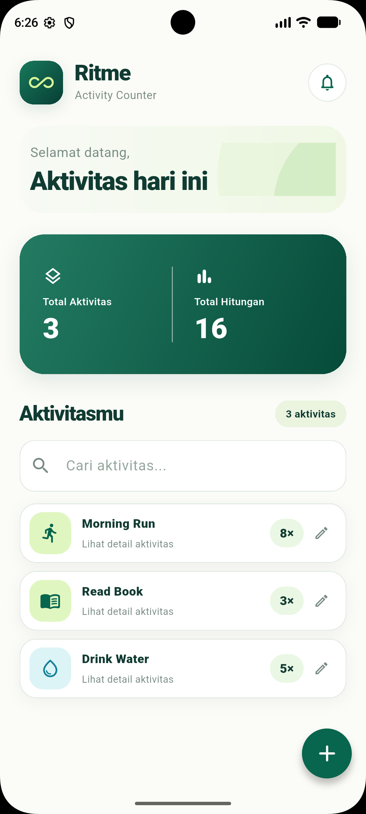
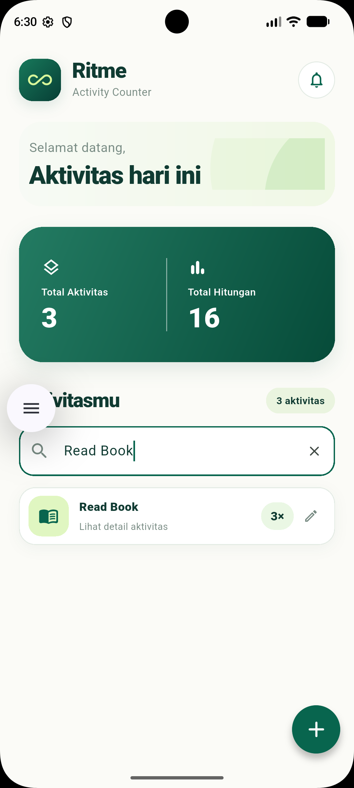
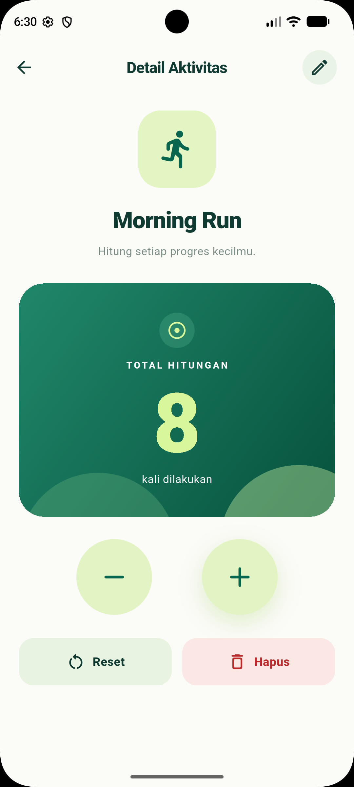
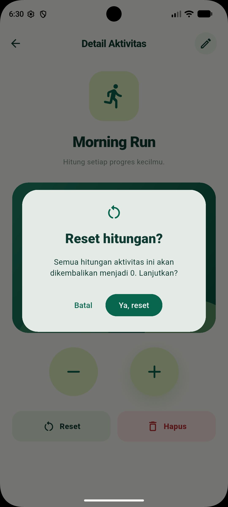
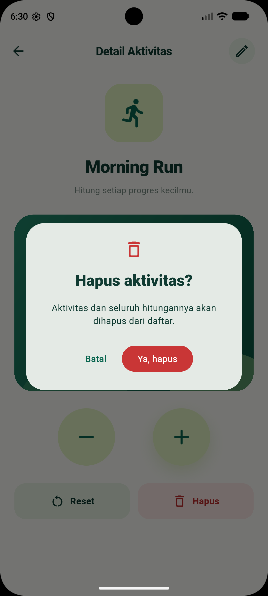

# 🌿 Ritme — Activity Counter
## 🎬 Video Demonstrasi Aplikasi

Berikut adalah video demonstrasi aplikasi Ritme — Activity Counter.

[](https://github.com/ariefrifansyah/Ritme-Activity-Counter/releases/tag/v1.0.0)

▶️ **[Tonton / Download Video Demonstrasi (MP4)](https://github.com/ariefrifansyah/Ritme-Activity-Counter/releases/download/v1.0.0/Demo_Ritme.mp4)**
<p align="center">
  <strong>Aplikasi Pencatat Aktivitas Berbasis Flutter dengan Arsitektur MVVM</strong>
</p>

<p align="center">
  
  
  
  
</p>

## 📌 Deskripsi Aplikasi

**Ritme** merupakan aplikasi mobile sederhana yang digunakan untuk mencatat dan menghitung aktivitas sehari-hari, seperti olahraga, membaca buku, belajar, dan aktivitas lainnya.

Aplikasi ini dikembangkan menggunakan Flutter dan bahasa pemrograman Dart dengan menerapkan arsitektur **Model–View–ViewModel (MVVM)**.

Ritme dirancang dengan tampilan modern, minimalis, dan menggunakan perpaduan warna emerald, hijau sage, serta lime.

## ✨ Fitur Aplikasi

- **Home:** Menampilkan daftar aktivitas, total aktivitas, dan total hitungan.
- **Pencarian:** Mencari aktivitas berdasarkan nama.
- **Tambah Aktivitas:** Menambahkan aktivitas baru.
- **Edit Aktivitas:** Mengubah nama aktivitas.
- **Detail Aktivitas:** Melihat informasi dan jumlah hitungan aktivitas.
- **Counter (+):** Menambahkan jumlah hitungan.
- **Counter (-):** Mengurangi jumlah hitungan tanpa melewati angka nol.
- **Reset:** Mengembalikan counter ke angka nol dengan konfirmasi.
- **Hapus:** Menghapus aktivitas dengan konfirmasi.
- **SnackBar:** Menampilkan pemberitahuan setelah tindakan pengguna.

## 📱 Screenshot Aplikasi

### 1. Halaman Home

Halaman utama menampilkan ringkasan aktivitas, total hitungan, dan daftar aktivitas yang telah dibuat.


### 2. Halaman Home dengan Pencarian

Pengguna dapat mencari aktivitas berdasarkan nama menggunakan fitur pencarian.



### 3. Halaman Detail Aktivitas

Halaman detail menampilkan nama aktivitas, jumlah hitungan, serta fitur pengelolaan counter.



### 4. Dialog Konfirmasi Reset

Menampilkan konfirmasi sebelum mengembalikan jumlah counter menjadi nol.



### 5. Dialog Konfirmasi Hapus

Menampilkan konfirmasi sebelum menghapus aktivitas dari daftar.



> Catatan: Screenshot halaman Form Tambah/Edit belum termasuk dalam lima gambar dokumentasi ini.

## 🏗️ Arsitektur MVVM

Aplikasi ini menggunakan arsitektur MVVM untuk memisahkan tanggung jawab setiap bagian program.

| Komponen | Fungsi |
|---|---|
| Model | Mendefinisikan struktur data aktivitas. |
| Data | Menyimpan data aktivitas sementara menggunakan List. |
| Repository | Mengelola operasi tambah, baca, edit, dan hapus data. |
| ViewModel | Mengelola logika aplikasi dan perubahan state. |
| View | Menampilkan antarmuka dan menerima interaksi pengguna. |

### Struktur Folder

```text
lib/
├── main.dart
├── models/
│   └── activity_model.dart
├── data/
│   └── activity_data.dart
├── repositories/
│   └── activity_repository.dart
├── viewmodels/
│   └── activity_viewmodel.dart
└── views/
    ├── home_view.dart
    ├── activity_form_view.dart
    └── activity_detail_view.dart
```

Jumlah file Dart pada folder `lib/` adalah **8 file**, sesuai ketentuan tugas.

## ⚙️ Teknologi yang Digunakan

- Flutter
- Dart
- Material 3
- ChangeNotifier
- InheritedNotifier
- Navigator
- List sebagai penyimpanan data sementara

**Penyimpanan data:** Data aktivitas disimpan sementara menggunakan List dan akan kembali ke data awal ketika aplikasi dijalankan ulang.

## 🚀 Cara Menjalankan Aplikasi

Pastikan Flutter SDK dan Android Studio atau Visual Studio Code sudah terpasang.

Buka terminal pada folder utama project, kemudian jalankan:

```bash
flutter pub get
```

Periksa perangkat yang tersedia:

```bash
flutter devices
```

Jalankan aplikasi:

```bash
flutter run
```

Untuk menjalankan melalui Chrome:

```bash
flutter run -d chrome
```

Untuk memeriksa kode:

```bash
flutter analyze
```

Untuk menjalankan pengujian:

```bash
flutter test
```

## 🎓 Informasi Project

| Keterangan | Detail |
|---|---|
| Nama Aplikasi | Ritme — Activity Counter |
| Mata Kuliah | Pemrograman Mobile |
| Framework | Flutter |
| Bahasa | Dart |
| Arsitektur | MVVM |
| Jenis Project | Ujian Tengah Semester (UTS) |

## 👨‍🎓 Identitas Mahasiswa

- **Nama:** [Moch.Arieef Rifansyah]
- **NIM:** [20240040194]
- **Kelas:** [TI24B]
- **Program Studi:** [Teknik Informaktika]
- **Perguruan Tinggi:** [Nusa Putra]

---

<p align="center">
  <strong>RITME — Small Steps, Big Progress 🌿</strong>
  <br/>
  <sub>Project UTS Pemrograman Mobile</sub>
</p>
